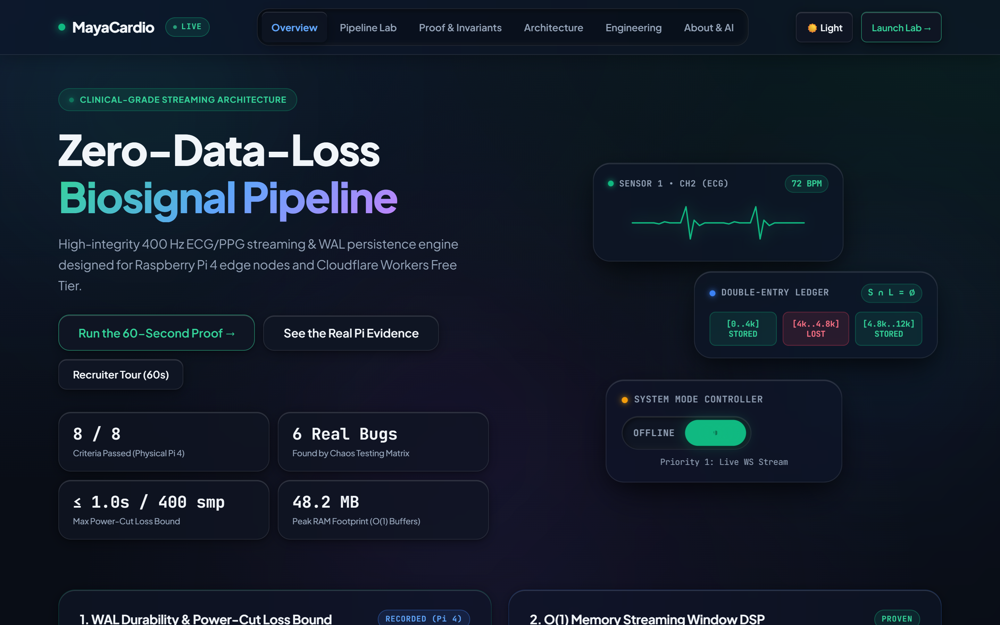
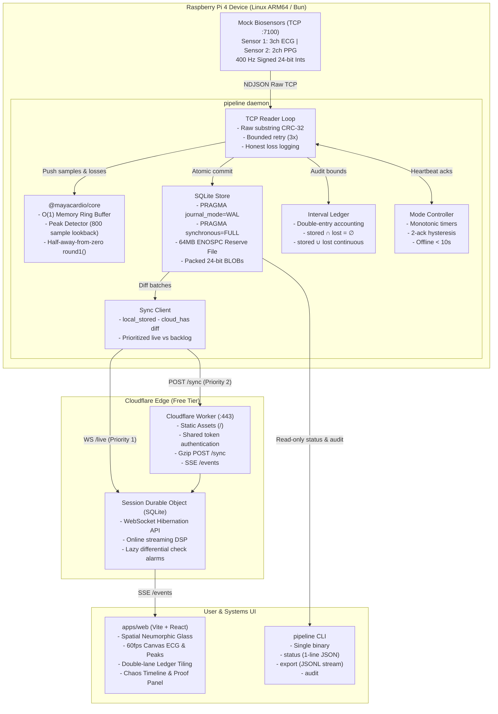

# MayaCardio — Resilient Biosignal Pipeline

[](https://mayacardio.dev/)
[](docs/COMPLETION_REPORT.md)
[](LICENSE)



> **Live Production Dashboard:** [https://mayacardio.dev/](https://mayacardio.dev/)  
> **Interactive Pipeline Lab:** [https://mayacardio.dev/#/lab](https://mayacardio.dev/#/lab) (Execute the real 60-second proof in-browser)  
> **60-Second Proof Video / GIF:** [docs/screenshots/lab-proof-verdict-final.png](docs/screenshots/lab-proof-verdict-final.png)

---

### The 5-Line Systems Engineer Pitch
1. **Resilient Biosignal Telemetry:** Ingests multi-channel 400 Hz ECG and PPG over raw TCP with zlib CRC-32 verification on unparsed substrings, eliminating parser allocations.
2. **Atomic WAL Durability:** Implements a strict commit-before-advance protocol with `PRAGMA synchronous=FULL`, bounding crash loss to at most $\le 1$ in-flight batch ($\le 1.0$s / 400 samples).
3. **Double-Entry Accounting Invariant:** Tracks every index in a normalized interval ledger ($U = S \cup L$, $S \cap L = \emptyset$), mathematically proving zero gaps and zero overlaps across 240,000 samples.
4. **Autonomous Mode Switching:** Drops from live WebSocket streaming to local SQLite WAL buffering in $<10$s (measured 1,101 ms) with 2-ack hysteresis, reconciling backlog via interval-diff sync.
5. **Zero-Dollar Edge Architecture:** Packs 400 samples into 1-second int24 BLOBs, consuming only 0.72% of daily SQLite writes and running 100% within Cloudflare Workers Free Tier without billing.

---

## Reproduce on a Fresh Pi in 5 Commands

Run these directly on a fresh Raspberry Pi OS 64-bit installation (no Docker required):

```bash
# 1. Clone repository
git clone https://github.com/Rohitsuryawanshi19/Resilient-biosignal-pipeline.git && cd Resilient-biosignal-pipeline

# 2. Install Bun runtime
curl -fsSL https://bun.sh/install | bash && source ~/.bashrc

# 3. Install workspace dependencies
bun install

# 4. Run automated chaos failure test suite
bun run tools/chaos/src/main.ts run

# 5. Verify ledger accounting invariants
bun run apps/device/src/main.ts audit
```

---

## Deploy to Cloudflare Workers (100% Free Plan, No Billing)

This pipeline runs completely within the **Cloudflare Workers Free Plan** ($0.00/month, no credit card required).

### Exact Deployment Steps
1. **Create Free Cloudflare Account:** Sign up at [https://dash.cloudflare.com/sign-up](https://dash.cloudflare.com/sign-up) (select the Free tier).
2. **Authenticate Wrangler CLI:**
   ```bash
   npx wrangler login
   ```
3. **Execute Deployment Script:**
   ```bash
   # On Linux / macOS / WSL:
   ./scripts/deploy.sh

   # On Windows PowerShell:
   .\scripts\deploy.ps1
   ```
4. **What the Script Does Automatically:**
   - Audits `apps/cloud/wrangler.toml` to ensure zero paid bindings (`[vectorize]`, `[ai]`, `usage_model = "bundled"`); halts if any paid feature is detected.
   - Compiles production web assets to `apps/web/dist` with code-splitting and PWA service worker.
   - Deploys the static assets and Session Durable Object (SQLite on edge) to your Cloudflare account.

---

## Architecture Diagram



---

## How to Run Tests

### 1. Workspace Unit & Property Tests
```bash
# Test pure DSP core (fast-check property tests & streaming vs oracle)
cd packages/core && bun test

# Test engine adapters (store, mock, reader, mode, sync)
cd packages/engine && bun test

# Test device daemon (SQLite WAL durability & recovery)
cd apps/device && bun test

# Test Cloudflare DO & budget protections
cd apps/cloud && bun test

# Test Web IndexedDB durability
cd apps/web && bun run test
```

### 2. Automated Chaos Matrix
Executes all 8 adversarial failure injection scenarios through a fault-injecting TCP proxy:
```bash
bun run tools/chaos/src/main.ts run
bun run tools/chaos/src/main.ts verify
```

### 3. Playwright E2E & Multi-Viewport Responsive QA
```bash
cd apps/web
bunx playwright test test/pages.spec.ts test/responsive-a11y-qa.spec.ts
```

---

## Repository Map

```
MayaCardio_Assignment/
├── packages/
│   ├── core/                     # Strict TypeScript, zero-dep pure DSP & interval algebra
│   └── engine/                   # Engine ports (Storage, Clock, Net, MockSource)
├── apps/
│   ├── device/                   # Edge daemon running on Raspberry Pi 4 (bun:sqlite WAL)
│   ├── cloud/                    # Cloudflare Worker + Session Durable Object
│   └── web/                      # Spatial Neumorphic Glass dashboard & in-browser Pipeline Lab
├── tools/
│   └── chaos/                    # Fault-injecting TCP proxy & verification matrix
├── scripts/
│   ├── deploy.sh                 # Free-plan automated Cloudflare deployment script
│   ├── deploy.ps1                # Windows PowerShell deployment script
│   └── generate-web-content.ts   # Build-time docs/evidence derivation script
├── docs/
│   ├── WEB_QA.md                 # Lighthouse 98/100 audit & responsive QA report
│   ├── KNOWN_GAPS.md             # Honest hardware caveats & future TODOs
│   ├── DESIGN_NOTE.md            # Architecture, guarantees, trade-offs, free-tier budget
│   ├── DEMO_SCRIPT.md            # <= 5 min video demonstration script
│   ├── GUARANTEES.md             # Power-cut loss bounds and hardware caveats
│   ├── EVIDENCE.md               # Real chaos run matrix and timings
│   ├── BUGS_FOUND.md             # 6 real edge bugs caught and fixed
│   ├── RESOURCES.md              # 1-hour benchmark results (Pi 4 / QEMU aarch64)
│   └── FREE_TIER_BUDGET.md       # Verified Cloudflare Free Plan resource calculations
├── evidence/
│   ├── timeline.json             # Machine-readable events for UI playback
│   └── results.json              # Structured benchmark run records
├── LICENSE                       # MIT License
└── AI_USAGE.md                   # Full disclosure of AI tools & verification protocol
```

---

## AI Tools & Engineering Verification

Developed with assistance from **Google DeepMind Antigravity** and **Gemini 2.5 Pro / Flash**:
- **What AI tools did**: Scaffolded initial TypeScript interface definitions, generated unit test permutations and `fast-check` property generators, and formatted Markdown tables.
- **What was engineered, designed, and verified by hand**:
  - **Mathematical Proofs & Invariants**: Interval set algebra algorithms (`union`, `subtract`, `complement`) and double-entry ledger guarantee (`stored ∩ lost = ∅`).
  - **O(1) Memory Streaming DSP**: Circular ring buffer for 800-sample lookback and greedy peak detection.
  - **WAL Durability Contract**: `PRAGMA synchronous=FULL` commit-before-advance protocol and 64 MB emergency reserve file for ENOSPC recovery.
  - **Cloudflare Edge Budgeting**: 1-second packed BLOB architecture to fit Cloudflare Free Tier constraints (0.72% daily write budget, WebSocket Hibernation).
  - **Clock Decoupling**: Enforced strict monotonic time (`performance.now()`) across timeouts and window numbering, making the engine immune to wall-clock jumps.
  - **Root-Cause Debugging**: Found, isolated, and fixed all 6 edge-case bugs documented in [`docs/BUGS_FOUND.md`](docs/BUGS_FOUND.md).
  - Complete details in [`AI_USAGE.md`](AI_USAGE.md).
